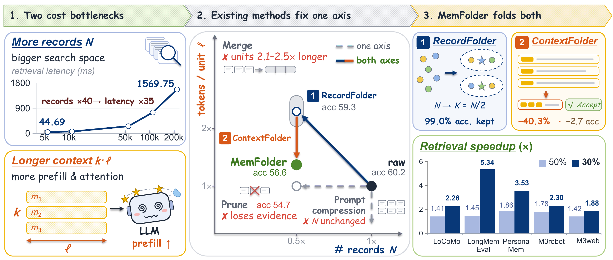

<div align="center">

# MemFolder

**Structure-Guided Memory Folding for Efficient Agent Memory Management**

Fewer retrieval units · Shorter contexts · Verified memory encoding

[](https://github.com/xuyang-liu16/MemFolder/actions/workflows/tests.yml) [](pyproject.toml) [](#documentation)

**English** | [简体中文](README.zh-CN.md)

[News](#news) · [Highlights](#highlights) · [Usage](#usage) · [Full results](#full-results)

</div>

<a id="news"></a>

## 🔥 News

- **2026-10-08:** The modular development release now includes experiment templates, paper figures, complete main-result tables, and English / Chinese guides.

<a id="highlights"></a>

## 📌 Highlights

- **Two stages, one shared structure.** RecordFolder consolidates related records into fewer retrieval units. ContextFolder reuses the same groups to encode their facts compactly and revise them using recovery checks.
- **Strong record compression.** With 50% fewer records, RecordFolder retains **99.0%** of uncompressed Mem0 performance averaged across LoCoMo, LongMemEval and PersonaMem.
- **Shorter retrieved contexts.** At the same 50% record reduction, ContextFolder further reduces tokens per record by **40.3% on LoCoMo** and **37.9% on LongMemEval** relative to RecordFolder alone.
- **Faster retrieval.** Keeping 30% of records yields up to **5.34×** mean retrieval acceleration in the paper's five evaluated settings.
- **Composable research infrastructure.** Swap grouping, context encoding, memory wrappers and evaluation through configuration. The framework includes Mem0, MemOS and M3 integrations, multiple baselines, and traceable experiment artifacts.

<div align="center">
<a href="docs/assets/paper-intro.png"></a>
</div>

**MemFolder at a glance (Figure 1).** Reduce the number of stored records and the text within each retrieval unit. The quantitative highlights above are paper-reported; detailed comparisons are at the end of this page.

<a id="usage"></a>
<a id="quick-start"></a>

## 🛠 Usage

### 1. Install

Requires **Python 3.11+**. The core package has no mandatory third-party dependencies.

```bash
git clone https://github.com/xuyang-liu16/MemFolder.git
cd MemFolder
python -m pip install -e .
```

### 2. Run the offline demo

```bash
python -m memfolder run examples/experiments/offline-demo.json
python -m memfolder verify build/experiments/offline-demo
```

The demo runs loading → compression → native output → retrieval → answering → evaluation, with an uncompressed control and case traces. It uses synthetic histories and a context-echo answerer; no model, API key or network access is required. Its `test_only` scores validate the workflow.

Run multiple methods and seeds:

```bash
python -m memfolder matrix examples/experiments/offline-matrix.json
```

Reuse a completed, verified run:

```bash
python -m memfolder run examples/experiments/offline-demo.json --resume
```

Artifacts stay under `build/experiments/`. Verification checks source fingerprints, configuration and output integrity.

### 3. Connect real memories and models

```bash
python -m pip install -e ".[algorithms,contextfolder,qdrant,evaluation]"
```

Start from the [RecordFolder template](examples/experiments/recordfolder-template.json) or [ContextFolder template](examples/experiments/contextfolder-template.json). Before running, replace the dataset and output paths, provider URLs, model names, revisions and embedding dimensions. Supply the provider key through the `MEMFOLDER_PROVIDER_KEY` environment variable. The templates' `REPLACE_*` and `api.example.invalid` values are placeholders.

After configuring the templates:

```bash
python -m memfolder run examples/experiments/recordfolder-template.json
python -m memfolder run examples/experiments/contextfolder-template.json
```

For an existing store, select a [native loader](docs/LOADING.md) with the `bank-initializer`. See the [experiment guide](docs/EXPERIMENTS.md) for assembly and the [wrapper guide](docs/WRAPPERS.md) for Mem0, MemOS and M3 formats. Benchmark questions and gold answers remain outside memory compression.

<a id="compose-an-experiment"></a>

### 4. Compose a different method

Record grouping and context writing are independent choices. For example, use ToMe groups with ContextFolder encoding by changing these fields in a complete configuration:

```json
{
  "compression": {
    "planner": {"plugin": "tome"},
    "operator": {"plugin": "contextfolder-operator"}
  },
  "run": {
    "mode": "repeat",
    "budgets": [{"unit": "nodes", "ratio": 0.5}]
  }
}
```

This is a configuration fragment; retain the template's features, wrapper, services, Reader and Evaluator. `ratio: 0.5` is a **record budget**. ContextFolder's token target is configured separately and is a soft target. ToMe text compression uses repeated rounds with fresh embeddings of rewritten text. See the [ToMe + ContextFolder recipe](examples/recipes/tome-with-contextfolder.json).

Set `run.evaluate_source` to `true` for an uncompressed control using the same Reader and Evaluator. Keep retrieval, prompts and scoring fixed when comparing compression methods.

<details>
<summary><b>Method overview and software architecture</b></summary>

<a id="paper"></a>

<div align="center">
<a href="docs/assets/paper-overview.pdf"></a>
</div>

The paper's RecordFolder and ContextFolder methods are available through separate Planner and Operator components. ContextFolder also accepts groups from other consolidation methods. The public paper link, author list and citation will be added when available.

<a id="architecture"></a>

<div align="center">

</div>

The **Planner** decides what to compress; the **Operator** executes those actions; the **Wrapper** preserves native storage and graph semantics; the **Reader and Evaluator** handle retrieval, answering and scoring. Gold labels enter only the Evaluator. Each role can come from a separate plugin package.

| Component | Included implementations |
| --- | --- |
| Paper methods | RecordFolder, ContextFolder |
| Record baselines | ToMe, MemForest, DART memory adaptations, StreamMeCo graph compression, RandomMerge, RandomPrune, KMeansMerge, KMeansPrune |
| Benchmarks | LoCoMo, LongMemEval, PersonaMem, M3-Bench robot/web |
| Memory loading and wrappers | Mem0, MemOS, M3 |
| Experiment tools | Configuration matrices, uncompressed controls, artifact verification, resume, observers and case queries |

Combinations must satisfy graph, time, modality and embedding requirements. StreamMeCo covers its graph compression stage; MemForest's MST implementation and historical M3 proxy have separate recipes. See [compatibility](docs/COMPATIBILITY.md) and [method variants](docs/COMPRESSION.md).

</details>

<a id="extend-one-module"></a>

### 5. Extend and inspect

Add a complete Planner, an Operator or one nested component by implementing its interface and a factory returning a `PluginSpec`:

```json
{
  "plugin": "my_module:build",
  "parameters": {"my_parameter": 0.5}
}
```

Installed packages can also register a `memfolder.plugins` entry point. The assembler checks roles, API versions and capabilities. Examples cover a [new benchmark](examples/plugins/new_benchmark), [anchor selection](examples/plugins/recency), [native output](examples/plugins/native_writer), and [answering or evaluation](examples/plugins/experiment_components). See the [extension guide](docs/EXTENDING.md).

<a id="inspect-the-data-flow"></a>

Enable case capture and a read-only observer:

```json
{
  "capture": {"profile": "cases", "text_policy": "omit"},
  "observers": [{"plugin": "event-report-observer", "required": false}]
}
```

Use [`FileRunReader`](docs/ANALYSIS.md) to follow source memories through grouping, compression, retrieval and answering, or compare runs by source identity. Missing observations are marked explicitly. Capture policies control public analysis projections; private run artifacts can still contain original memories and evaluation data.

<a id="documentation"></a>

### Documentation

| Task | Guide |
| --- | --- |
| Run experiments or parameter sweeps | [Experiments](docs/EXPERIMENTS.md) |
| Understand compression methods and variants | [Compression](docs/COMPRESSION.md) |
| Load memories or choose a benchmark protocol | [Loading](docs/LOADING.md) · [Benchmarks](docs/BENCHMARKS.md) |
| Export to a memory framework | [Wrappers](docs/WRAPPERS.md) |
| Add a component or inspect cases | [Extensions](docs/EXTENDING.md) · [Analysis](docs/ANALYSIS.md) |
| Check interfaces and supported combinations | [Contracts](docs/CONTRACTS.md) · [Compatibility](docs/COMPATIBILITY.md) |
| Read all category-level paper scores | [Paper results](docs/PAPER_RESULTS.md) |

<details>
<summary><b>Development, attribution and licensing</b></summary>

After installing optional dependencies, run:

```bash
python tools/fetch_test_sources.py
python tools/check_contracts.py
```

The source fetcher checks pinned upstream revisions and checksums. Downloads stay in ignored `build/` directories. Optional integration checks skip when their sources are unavailable; historical-archive checks require their separate archives. CI runs checks and the offline workflow on Python 3.11 and 3.12. Full paper-score reproduction, live backends and multimodal inference have their own [validation scope](docs/EXPERIMENTS.md#验证范围).

Method, benchmark and wrapper provenance are recorded in [these](docs/METHOD_PROVENANCE.json) [source](docs/BENCHMARK_SOURCES.json) [manifests](docs/WRAPPER_SOURCES.json). RecordFolder and ContextFolder are the formal names of the earlier G1S and V12 implementations. Third-party attribution, including StreamMeCo's MIT notice, is retained in [THIRD_PARTY_NOTICES.md](docs/THIRD_PARTY_NOTICES.md). A uniform license for historical source contributions has not yet been finalized; this release does not relicense them.

</details>

<a id="main-results"></a>
<a id="full-results"></a>

## 📊 Full results

All main comparisons are included below: 30% / 50% / 70% record reduction on Mem0, 50% / 70% on MemOS and M3-Agent, context compression, and retrieval efficiency. Values come from the supplied manuscript; this refactored release has not independently reproduced every paper score. See the [complete category breakdowns](docs/PAPER_RESULTS.md) and [exact values with provenance](docs/assets/paper-results-data.json).

### RecordFolder: record compression

Tables report overall benchmark accuracy, with averages and retention preserved from the paper. **Retention** is average accuracy relative to the corresponding uncompressed system. Bold rows identify our method. **70% record reduction means 30% of records retained**.

#### Mem0 · 50% fewer records

| Method | LoCoMo | LongMemEval | PersonaMem | Avg. | Retention (%) |
| --- | ---: | ---: | ---: | ---: | ---: |
| Mem0 (uncompressed) | 60.2 | 55.2 | 67.9 | 61.1 | 100.0 |
| Random Pruning | 43.1 | 43.6 | 64.3 | 50.3 | 82.3 |
| KMeans | 46.8 | 47.0 | 65.2 | 53.0 | 86.7 |
| DART | 51.9 | 41.4 | 64.3 | 52.5 | 85.9 |
| Random Merging | 51.4 | 48.6 | 64.5 | 54.8 | 89.7 |
| ToMe | 54.7 | 50.8 | 65.9 | 57.1 | 93.5 |
| MemForest | 58.4 | 51.8 | 67.7 | 59.3 | 97.1 |
| **MemFolder (RecordFolder)** | **59.3** | **55.0** | **67.2** | **60.5** | **99.0** |

<details>
<summary><b>Mem0 · 30 / 70% record reduction</b></summary>

#### Mem0 · 30% fewer records

| Method | LoCoMo | LongMemEval | PersonaMem | Avg. | Retention (%) |
| --- | ---: | ---: | ---: | ---: | ---: |
| Mem0 (uncompressed) | 60.2 | 55.2 | 67.9 | 61.1 | 100.0 |
| Random Pruning | 50.8 | 50.8 | 64.5 | 55.4 | 90.7 |
| KMeans | 56.8 | 52.0 | 65.7 | 58.2 | 95.3 |
| DART | 57.4 | 48.8 | 66.6 | 57.6 | 94.3 |
| Random Merging | 56.2 | 50.8 | 65.2 | 57.4 | 93.9 |
| ToMe | 57.2 | 51.2 | 66.4 | 58.3 | 95.4 |
| MemForest | 58.5 | 54.2 | 66.6 | 59.7 | 97.7 |
| **MemFolder (RecordFolder)** | **61.7** | **55.2** | **67.7** | **61.5** | **100.7** |

#### Mem0 · 70% fewer records

| Method | LoCoMo | LongMemEval | PersonaMem | Avg. | Retention (%) |
| --- | ---: | ---: | ---: | ---: | ---: |
| Mem0 (uncompressed) | 60.2 | 55.2 | 67.9 | 61.1 | 100.0 |
| Random Pruning | 33.1 | 28.6 | 63.7 | 41.8 | 68.4 |
| KMeans | 36.7 | 34.8 | 63.8 | 45.1 | 73.8 |
| DART | 43.6 | 30.6 | 61.8 | 45.3 | 74.1 |
| Random Merging | 50.7 | 46.2 | 64.0 | 53.6 | 87.7 |
| ToMe | 52.7 | 49.6 | 65.7 | 56.0 | 91.7 |
| MemForest | 54.4 | 52.2 | 64.4 | 57.0 | 93.3 |
| **MemFolder (RecordFolder)** | **57.1** | **55.0** | **64.9** | **59.0** | **96.6** |

</details>

<details>
<summary><b>MemOS · 50 / 70% record reduction</b></summary>

#### MemOS · 50% fewer records

| Method | LoCoMo | LongMemEval | PersonaMem | Avg. | Retention (%) |
| --- | ---: | ---: | ---: | ---: | ---: |
| MemOS (uncompressed) | 79.0 | 74.0 | 60.3 | 71.1 | 100.0 |
| Random Pruning | 65.3 | 47.8 | 55.9 | 56.3 | 79.2 |
| KMeans | 67.8 | 47.6 | 54.7 | 56.7 | 79.7 |
| DART | 70.1 | 40.8 | 53.7 | 54.9 | 77.2 |
| Random Merging | 73.3 | 59.6 | 56.2 | 63.0 | 88.7 |
| ToMe | 71.0 | 61.8 | 57.9 | 63.6 | 89.4 |
| MemForest | 76.0 | 60.0 | 54.8 | 63.6 | 89.5 |
| **MemFolder (RecordFolder)** | **75.3** | **64.2** | **54.7** | **64.7** | **91.0** |

#### MemOS · 70% fewer records

| Method | LoCoMo | LongMemEval | PersonaMem | Avg. | Retention (%) |
| --- | ---: | ---: | ---: | ---: | ---: |
| MemOS (uncompressed) | 79.0 | 74.0 | 60.3 | 71.1 | 100.0 |
| Random Pruning | 54.9 | 30.2 | 52.8 | 46.0 | 64.7 |
| KMeans | 57.3 | 31.6 | 52.6 | 47.2 | 66.4 |
| DART | 59.8 | 26.8 | 48.9 | 45.2 | 63.5 |
| Random Merging | 68.1 | 53.8 | 54.0 | 58.6 | 82.5 |
| ToMe | 67.4 | 53.4 | 55.4 | 58.7 | 82.6 |
| MemForest | 70.7 | 50.0 | 55.5 | 58.7 | 82.6 |
| **MemFolder (RecordFolder)** | **71.3** | **54.4** | **55.2** | **60.3** | **84.8** |

</details>

<details>
<summary><b>M3-Agent · 50 / 70% record reduction</b></summary>

#### M3-Agent · 50% fewer records

| Method | Robot | Web | Avg. | Retention (%) |
| --- | ---: | ---: | ---: | ---: |
| M3-Agent (uncompressed) | 30.3 | 47.9 | 39.1 | 100.0 |
| Random Pruning | 28.1 | 41.2 | 34.7 | 88.7 |
| KMeans | 29.2 | 43.9 | 36.6 | 93.6 |
| DART | 29.1 | 43.1 | 36.1 | 92.3 |
| StreamMeCo | 30.6 | 44.7 | 37.7 | 96.2 |
| Random Merging | 30.8 | 44.6 | 37.7 | 96.4 |
| ToMe | 30.9 | 46.1 | 38.5 | 98.5 |
| MemForest | 31.6 | 46.5 | 39.0 | 99.7 |
| **MemFolder (RecordFolder)** | **31.0** | **48.2** | **39.6** | **101.3** |

#### M3-Agent · 70% fewer records

| Method | Robot | Web | Avg. | Retention (%) |
| --- | ---: | ---: | ---: | ---: |
| M3-Agent (uncompressed) | 30.3 | 47.9 | 39.1 | 100.0 |
| Random Pruning | 27.7 | 37.3 | 32.5 | 83.1 |
| KMeans | 28.9 | 39.1 | 34.0 | 87.0 |
| DART | 27.2 | 39.2 | 33.2 | 84.9 |
| StreamMeCo | 28.4 | 41.9 | 35.1 | 89.8 |
| Random Merging | 30.4 | 43.2 | 36.8 | 94.1 |
| ToMe | 30.6 | 45.7 | 38.2 | 97.7 |
| MemForest | 30.7 | 46.3 | 38.5 | 98.5 |
| **MemFolder (RecordFolder)** | **31.4** | **48.7** | **40.1** | **102.6** |

</details>

### ContextFolder: context compression

<div align="center">
<a href="docs/assets/paper-context-results.pdf"></a>
</div>

**Accuracy versus tokens per record at 50% record reduction.** Upper left is better. Colors identify record compressors; markers identify context compressors. After RecordFolder, ContextFolder further reduces tokens per record by **40.3% on LoCoMo** and **37.9% on LongMemEval**, with final accuracy of **56.6%** and **51.8%**, respectively. Token reductions are relative to RecordFolder alone.

### Retrieval efficiency

<div align="center">
<a href="docs/assets/paper-retrieval-efficiency.pdf"></a>
</div>

**Mean and P95 retrieval latency.** Keeping 30% of records yields the paper-reported **1.88–5.34×** mean speedups across five settings. The figure shows records **retained**; the tables above show records **removed**. Click the figures for the original PDFs.

Some LongMemEval reference scores differ between the supplied main tables and context figure. Each keeps its original values; see the [source consistency note](docs/PAPER_RESULTS.md#source-consistency).
