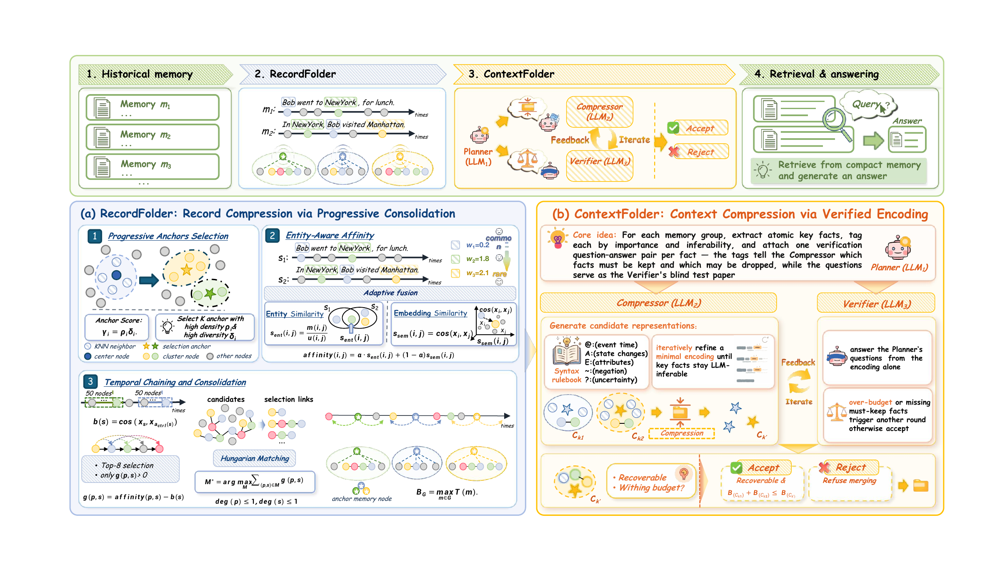

<div align="center">

# MemFolder

**Structure-Guided Memory Folding for Efficient Agent Memory Management**

Compress stored memories, retrieve relevant history, and answer with shorter context.

[](https://github.com/xuyang-liu16/MemFolder/actions/workflows/tests.yml) [](pyproject.toml) [](docs/README.md)

**English** | [简体中文](README.zh-CN.md)

[News](#news) · [Highlights](#highlights) · [Overview](#overview) · [Usage](#usage) · [Full results](#full-results)

</div>

<div align="center">
<a href="docs/assets/paper-intro.png"></a>
</div>

**Graphical abstract.** RecordFolder reduces the number of retrieval units. ContextFolder reduces the text inside each unit, with fact-recovery checks guiding the encoding.

<a id="news"></a>

## News

- **2026-10-08:** Updated the project overview, experiment guides, and complete paper results, with English and Chinese documentation.

<a id="highlights"></a>

## Highlights

- **Compress both record count and text length.** RecordFolder consolidates related memories; ContextFolder shortens each group's text and checks recovery of its important facts.
- **Preserve answer quality with fewer records.** At 50% record reduction, RecordFolder retains **99.0%** of the original Mem0 system's mean accuracy across LoCoMo, LongMemEval, and PersonaMem.
- **Read shorter context.** At that record budget, ContextFolder further reduces tokens per record by **40.3% on LoCoMo** and **37.9% on LongMemEval**, relative to RecordFolder alone.
- **Retrieve faster.** Keeping 30% of records gives up to **5.34×** mean retrieval speedup across the paper's five evaluation settings.

The figures and values on this page report the paper's experiments. The repository provides configurable methods, data loaders, and evaluation tools for running your own comparisons.

<a id="overview"></a>

## Overview

As an agent accumulates memories, it has more records to search and more text to read. MemFolder addresses both costs in sequence: first consolidate related records, then encode their content more compactly.

The method follows the four stages shown below:

1. **Load historical memory.** Preserve record content, entities, event times, and source references.
2. **Group with RecordFolder.** Select representative memories and combine entity similarity, semantic similarity, and temporal links to consolidate related records.
3. **Encode with ContextFolder.** Extract key facts, write a compact representation, and revise it using a verifier's answers to fact-recovery questions.
4. **Retrieve and answer.** Search the compressed memory and pass the retrieved content to the answering model.

<div align="center">
<a href="docs/assets/paper-overview.pdf"></a>
</div>

**Method overview.** The lower panels show anchor selection and temporal consolidation in RecordFolder, followed by fact planning, encoding, and verification in ContextFolder. Click the figure to open the PDF. See [Compression methods](docs/COMPRESSION.md) for the implementation and configuration options.

<a id="usage"></a>
<a id="quick-start"></a>

## Usage

### Install and run an example

Use Python 3.11 or newer. From a shell:

```bash
git clone https://github.com/xuyang-liu16/MemFolder.git
cd MemFolder
python -m pip install -e .
python -m memfolder run examples/experiments/offline-demo.json
python -m memfolder verify build/experiments/offline-demo
```

The example runs locally on a tiny synthetic conversation. It groups records, saves the compressed memory, retrieves context, and writes evaluation and diagnostic files under `build/experiments/offline-demo`. Its `test_only` scores help check the workflow.

### Run RecordFolder or ContextFolder

Install the dependencies for the supplied experiment templates:

```bash
python -m pip install -e ".[algorithms,contextfolder,evaluation]"
```

Open [recordfolder-template.json](examples/experiments/recordfolder-template.json) or [contextfolder-template.json](examples/experiments/contextfolder-template.json). Set your dataset path, provider URLs, model names and revisions, embedding dimension, and output directory. Supply your API key through `MEMFOLDER_PROVIDER_KEY` in the current shell. The [experiment guide](docs/EXPERIMENTS.md) lists the fields and shell commands.

Run the configured template:

```bash
python -m memfolder run examples/experiments/recordfolder-template.json
python -m memfolder run examples/experiments/contextfolder-template.json
```

Both templates retain half of the eligible records and evaluate the original and compressed memories. ContextFolder also measures text length with the configured tokenizer. To use an existing Mem0, MemOS, or M3 store, follow [Loading memories](docs/LOADING.md).

### Compare and inspect runs

```bash
python -m memfolder matrix examples/experiments/offline-matrix.json
python -m memfolder run examples/experiments/offline-demo.json --resume
python -m memfolder case build/experiments/offline-demo --dataset-id locomo --sample-id demo --question-id demo:0 --output build/cases/demo-question
```

The matrix compares two methods across two seeds. `--resume` reuses a completed run after checking its inputs and saved files. The `case` command exports the records and events associated with one question. Choose a new output directory for each new experiment or case export.

<a id="documentation"></a>

### Documentation

| Task | Guide |
| --- | --- |
| Configure and run experiments | [Experiments](docs/EXPERIMENTS.md) |
| Choose a compression method | [Compression methods](docs/COMPRESSION.md) |
| Load memories and evaluate answers | [Loading](docs/LOADING.md) · [Benchmarks](docs/BENCHMARKS.md) |
| Write memory to a framework | [Framework integration](docs/WRAPPERS.md) |
| Investigate an answer or add a component | [Analysis](docs/ANALYSIS.md) · [Extensions](docs/EXTENDING.md) |
| Check data types and supported configurations | [Interfaces](docs/CONTRACTS.md) · [Compatibility](docs/COMPATIBILITY.md) |

The [documentation index](docs/README.md) provides reading paths. Source revisions and attribution appear in [Third-party notices](docs/THIRD_PARTY_NOTICES.md); licensing for historical contributions remains under review.

<a id="main-results"></a>
<a id="full-results"></a>

## Full results

The following tables and figures cover record compression, context compression, and retrieval efficiency. Values come from the manuscript. The [complete tables](docs/PAPER_RESULTS.md) include category-level scores, and the [data file](docs/assets/paper-results-data.json) records the exact values and their sources.

### RecordFolder: record compression

Accuracy, average accuracy, and retention are percentages. **Retention** compares a method's mean accuracy with its original uncompressed system. A **70% reduction** leaves **30% of records**. Bold rows show RecordFolder, labeled MemFolder in the paper tables.

#### Mem0 · 50% fewer records

| Method | LoCoMo | LongMemEval | PersonaMem | Avg. | Retention (%) |
| --- | ---: | ---: | ---: | ---: | ---: |
| Mem0 (uncompressed) | 60.2 | 55.2 | 67.9 | 61.1 | 100.0 |
| Random Pruning | 43.1 | 43.6 | 64.3 | 50.3 | 82.3 |
| KMeans | 46.8 | 47.0 | 65.2 | 53.0 | 86.7 |
| DART | 51.9 | 41.4 | 64.3 | 52.5 | 85.9 |
| Random Merging | 51.4 | 48.6 | 64.5 | 54.8 | 89.7 |
| ToMe | 54.7 | 50.8 | 65.9 | 57.1 | 93.5 |
| MemForest | 58.4 | 51.8 | 67.7 | 59.3 | 97.1 |
| **MemFolder (RecordFolder)** | **59.3** | **55.0** | **67.2** | **60.5** | **99.0** |

<details>
<summary><b>Mem0 · 30 / 70% record reduction</b></summary>

#### Mem0 · 30% fewer records

| Method | LoCoMo | LongMemEval | PersonaMem | Avg. | Retention (%) |
| --- | ---: | ---: | ---: | ---: | ---: |
| Mem0 (uncompressed) | 60.2 | 55.2 | 67.9 | 61.1 | 100.0 |
| Random Pruning | 50.8 | 50.8 | 64.5 | 55.4 | 90.7 |
| KMeans | 56.8 | 52.0 | 65.7 | 58.2 | 95.3 |
| DART | 57.4 | 48.8 | 66.6 | 57.6 | 94.3 |
| Random Merging | 56.2 | 50.8 | 65.2 | 57.4 | 93.9 |
| ToMe | 57.2 | 51.2 | 66.4 | 58.3 | 95.4 |
| MemForest | 58.5 | 54.2 | 66.6 | 59.7 | 97.7 |
| **MemFolder (RecordFolder)** | **61.7** | **55.2** | **67.7** | **61.5** | **100.7** |

#### Mem0 · 70% fewer records

| Method | LoCoMo | LongMemEval | PersonaMem | Avg. | Retention (%) |
| --- | ---: | ---: | ---: | ---: | ---: |
| Mem0 (uncompressed) | 60.2 | 55.2 | 67.9 | 61.1 | 100.0 |
| Random Pruning | 33.1 | 28.6 | 63.7 | 41.8 | 68.4 |
| KMeans | 36.7 | 34.8 | 63.8 | 45.1 | 73.8 |
| DART | 43.6 | 30.6 | 61.8 | 45.3 | 74.1 |
| Random Merging | 50.7 | 46.2 | 64.0 | 53.6 | 87.7 |
| ToMe | 52.7 | 49.6 | 65.7 | 56.0 | 91.7 |
| MemForest | 54.4 | 52.2 | 64.4 | 57.0 | 93.3 |
| **MemFolder (RecordFolder)** | **57.1** | **55.0** | **64.9** | **59.0** | **96.6** |

</details>

<details>
<summary><b>MemOS · 50 / 70% record reduction</b></summary>

#### MemOS · 50% fewer records

| Method | LoCoMo | LongMemEval | PersonaMem | Avg. | Retention (%) |
| --- | ---: | ---: | ---: | ---: | ---: |
| MemOS (uncompressed) | 79.0 | 74.0 | 60.3 | 71.1 | 100.0 |
| Random Pruning | 65.3 | 47.8 | 55.9 | 56.3 | 79.2 |
| KMeans | 67.8 | 47.6 | 54.7 | 56.7 | 79.7 |
| DART | 70.1 | 40.8 | 53.7 | 54.9 | 77.2 |
| Random Merging | 73.3 | 59.6 | 56.2 | 63.0 | 88.7 |
| ToMe | 71.0 | 61.8 | 57.9 | 63.6 | 89.4 |
| MemForest | 76.0 | 60.0 | 54.8 | 63.6 | 89.5 |
| **MemFolder (RecordFolder)** | **75.3** | **64.2** | **54.7** | **64.7** | **91.0** |

#### MemOS · 70% fewer records

| Method | LoCoMo | LongMemEval | PersonaMem | Avg. | Retention (%) |
| --- | ---: | ---: | ---: | ---: | ---: |
| MemOS (uncompressed) | 79.0 | 74.0 | 60.3 | 71.1 | 100.0 |
| Random Pruning | 54.9 | 30.2 | 52.8 | 46.0 | 64.7 |
| KMeans | 57.3 | 31.6 | 52.6 | 47.2 | 66.4 |
| DART | 59.8 | 26.8 | 48.9 | 45.2 | 63.5 |
| Random Merging | 68.1 | 53.8 | 54.0 | 58.6 | 82.5 |
| ToMe | 67.4 | 53.4 | 55.4 | 58.7 | 82.6 |
| MemForest | 70.7 | 50.0 | 55.5 | 58.7 | 82.6 |
| **MemFolder (RecordFolder)** | **71.3** | **54.4** | **55.2** | **60.3** | **84.8** |

</details>

<details>
<summary><b>M3-Agent · 50 / 70% record reduction</b></summary>

#### M3-Agent · 50% fewer records

| Method | Robot | Web | Avg. | Retention (%) |
| --- | ---: | ---: | ---: | ---: |
| M3-Agent (uncompressed) | 30.3 | 47.9 | 39.1 | 100.0 |
| Random Pruning | 28.1 | 41.2 | 34.7 | 88.7 |
| KMeans | 29.2 | 43.9 | 36.6 | 93.6 |
| DART | 29.1 | 43.1 | 36.1 | 92.3 |
| StreamMeCo | 30.6 | 44.7 | 37.7 | 96.2 |
| Random Merging | 30.8 | 44.6 | 37.7 | 96.4 |
| ToMe | 30.9 | 46.1 | 38.5 | 98.5 |
| MemForest | 31.6 | 46.5 | 39.0 | 99.7 |
| **MemFolder (RecordFolder)** | **31.0** | **48.2** | **39.6** | **101.3** |

#### M3-Agent · 70% fewer records

| Method | Robot | Web | Avg. | Retention (%) |
| --- | ---: | ---: | ---: | ---: |
| M3-Agent (uncompressed) | 30.3 | 47.9 | 39.1 | 100.0 |
| Random Pruning | 27.7 | 37.3 | 32.5 | 83.1 |
| KMeans | 28.9 | 39.1 | 34.0 | 87.0 |
| DART | 27.2 | 39.2 | 33.2 | 84.9 |
| StreamMeCo | 28.4 | 41.9 | 35.1 | 89.8 |
| Random Merging | 30.4 | 43.2 | 36.8 | 94.1 |
| ToMe | 30.6 | 45.7 | 38.2 | 97.7 |
| MemForest | 30.7 | 46.3 | 38.5 | 98.5 |
| **MemFolder (RecordFolder)** | **31.4** | **48.7** | **40.1** | **102.6** |

</details>

### ContextFolder: context compression

<div align="center">
<a href="docs/assets/paper-context-results.pdf"></a>
</div>

**Accuracy versus tokens per record at 50% record reduction.** Upper left is better. Colors identify record compressors; markers identify context compressors. After RecordFolder, ContextFolder further reduces tokens per record by **40.3% on LoCoMo** and **37.9% on LongMemEval**, with final accuracy of **56.6%** and **51.8%**, respectively. Token reductions are relative to RecordFolder alone.

### Retrieval efficiency

<div align="center">
<a href="docs/assets/paper-retrieval-efficiency.pdf"></a>
</div>

**Mean and P95 retrieval latency.** Keeping 30% of records yields the paper-reported **1.88–5.34×** mean speedups across five settings. The figure shows records **retained**; the tables above show records **removed**. Click the figures for the original PDFs.

Some LongMemEval reference scores differ between the supplied main tables and context figure. Each keeps its original values; see the [source consistency note](docs/PAPER_RESULTS.md#source-consistency).
