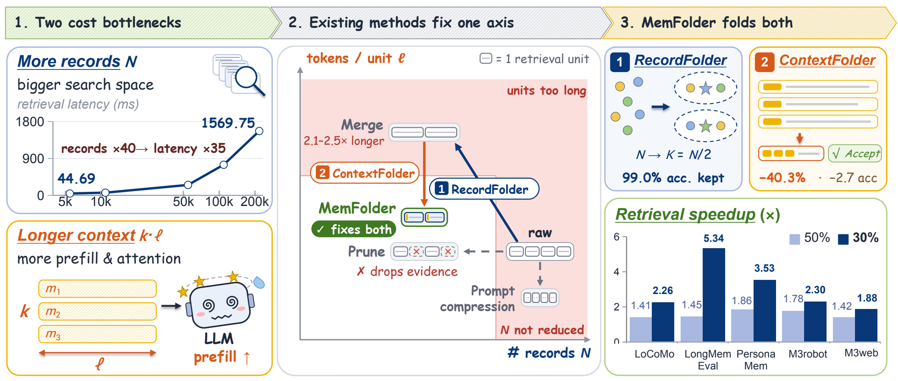

<div align="center">
<h1>MemFolder: Structure-Guided Memory Folding<br>for Efficient Agent Memory Management</h1>

<p>
  <strong>English</strong> | <a href="README.zh-CN.md">中文</a>
</p>

<p>
Xuyang Liu<sup>1,*</sup>,
Chenwen Lu<sup>1,*</sup>,
Junxi Wang<sup>2</sup>,
Siyu Ren<sup>1</sup>,
Xinying Lin<sup>3</sup>,
<br>
Siteng Huang<sup>4</sup>,
Hongli Sun<sup>1</sup>,
Linfeng Zhang<sup>5</sup>,
Honggang Chen<sup>1,&dagger;</sup>
<br><br>
<sup>1</sup> Sichuan University &nbsp;
<sup>2</sup> Fudan University &nbsp;
<sup>3</sup> Sun Yat-sen University
<br>
<sup>4</sup> Zhejiang University &nbsp;
<sup>5</sup> Shanghai Jiao Tong University
<br><br>
<sup>*</sup> Equal contribution. &nbsp; <sup>&dagger;</sup> Corresponding author.
</p>
</div>

<p align="center">

</p>

> **TLDR:** As agent memory grows, retrieving records and processing the resulting context become increasingly costly.
> To reduce these costs, we propose **MemFolder**, which combines **RecordFolder** for record compression and **ContextFolder** for context compression.

<a id="news"></a>

## 🔥 News

- **`2026.11.20`** Explore how MemFolder groups memory records and shortens the text retrieved for each query in the [updated overview](#overview). Try both stages on LoCoMo with the [experiment guide](#quick-start).

<a id="highlights"></a>

## 🎯 Highlights

- **Half as many records.** RecordFolder retains **99.0%** of Mem0's original mean accuracy across LoCoMo, LongMemEval and PersonaMem, compared with **97.1%** for MemForest at the same record count.
- **Shorter records.** After RecordFolder halves the record count, ContextFolder cuts tokens per record by a further **40.3%** on LoCoMo and **37.9%** on LongMemEval.
- **Faster retrieval.** Keeping 30% of the records speeds up retrieval by **1.88× to 5.34×** across five settings. The largest speedup is on LongMemEval.

<a id="overview"></a>

## ✨ Overview

<p align="center">

</p>

MemFolder has two modules: **RecordFolder** selects complementary anchors and consolidates related records through entity-aware affinity and temporal chains, reducing the number of retrieval units. **ContextFolder** uses a planner to prioritize facts, a compressor to generate compact encodings, and a blind verifier to check recovery and guide revision.

<a id="usage"></a>
<a id="quick-start"></a>

## Usage

As for Coding Agent users, use the following prompt to start an experiment with the bundled [memfolder-exp skill](skills/SKILL.md):

> Follow `skills/SKILL.md` in `https://github.com/xuyang-liu16/MemFolder` to run a LoCoMo pilot comparing RecordFolder and ContextFolder at 50% node retention with my configured model services.

The agent checks the environment, downloads the required data and prepares the configuration. After confirming model services and the run budget, it runs evaluation, verifies the outputs and summarizes the results.

### Experiment workflow

#### 1. Install

Use Python 3.11 or newer. Run the commands below from the repository root in Bash or a compatible shell.

```bash
git clone https://github.com/xuyang-liu16/MemFolder.git
cd MemFolder
python3 -m venv .venv
source .venv/bin/activate
python -m pip install -e .
python -m memfolder --help
```

For RecordFolder and ContextFolder, install:

```bash
python -m pip install -e ".[algorithms,contextfolder,evaluation]"
```

#### 2. Download data

Experiments need **benchmark conversations/questions** and an **input memory store**. For an initial LoCoMo run, download the conversations below and keep the template's `history-initializer`, which creates one record per turn. For Mem0 or MemOS experiments, load a separately generated memory store instead.

```bash
mkdir -p data/locomo
curl -fL https://raw.githubusercontent.com/snap-research/locomo/3eb6f2c585f5e1699204e3c3bdf7adc5c28cb376/data/locomo10.json \
  -o data/locomo/locomo10.json
```

| Benchmark | Download | Dataset plugin and inputs |
| --- | --- | --- |
| LoCoMo | [Official release](https://github.com/snap-research/locomo) | `locomo-dataset`: `locomo10.json` |
| LongMemEval | [Official data](https://huggingface.co/datasets/xiaowu0162/longmemeval-cleaned) | `longmemeval-dataset`: e.g. `longmemeval_s_cleaned.json` |
| PersonaMem v1, 32K | [Official data](https://huggingface.co/datasets/bowen-upenn/PersonaMem) | `personamem-dataset`: `questions_32k.csv` and `shared_contexts_32k.jsonl` |
| M3-Bench robot/web | [Annotations](https://github.com/ByteDance-Seed/m3-agent/tree/master/data/annotations), [memory graphs](https://huggingface.co/datasets/ByteDance-Seed/M3-Bench/tree/main/memory_graphs) | `m3-dataset`: `robot.json` or `web.json`, plus a memory loader for each video |

<details>
<summary><b>Download commands for LongMemEval, PersonaMem and M3 annotations</b></summary>

Download only the benchmark you need:

```bash
mkdir -p data/longmemeval
curl -fL https://huggingface.co/datasets/xiaowu0162/longmemeval-cleaned/resolve/main/longmemeval_s_cleaned.json \
  -o data/longmemeval/longmemeval_s_cleaned.json

mkdir -p data/personamem
curl -fL https://huggingface.co/datasets/bowen-upenn/PersonaMem/resolve/main/questions_32k.csv \
  -o data/personamem/questions_32k.csv
curl -fL https://huggingface.co/datasets/bowen-upenn/PersonaMem/resolve/main/shared_contexts_32k.jsonl \
  -o data/personamem/shared_contexts_32k.jsonl

mkdir -p data/m3
curl -fL https://raw.githubusercontent.com/ByteDance-Seed/m3-agent/0e3e41939bd8a0b66d756e7b7eb8d5fe9992da5c/data/annotations/robot.json \
  -o data/m3/robot.json
curl -fL https://raw.githubusercontent.com/ByteDance-Seed/m3-agent/0e3e41939bd8a0b66d756e7b7eb8d5fe9992da5c/data/annotations/web.json \
  -o data/m3/web.json
```

Use the corresponding entry in [dataset-components.json](examples/experiments/dataset-components.json) as the experiment's `dataset` section. Set `contexts_path` for PersonaMem, and `memory_loaders` plus `variant` for M3. Download both M3 annotations and memory graphs, preserving media paths and clip cutoffs. Full multimodal evaluation also requires the [M3-Agent controller setup](https://github.com/ByteDance-Seed/m3-agent#control).

Use the original benchmark formats with these loaders. MemForest's `dataset/longmemeval.json` and `dataset/personamem_32k.json` use a converted LoCoMo-style schema and require a matching adapter. Keep the dataset version, memory snapshot and scoring protocol matched.

</details>

<details>
<summary><b>Use a prebuilt Mem0 store</b></summary>

[MemForest_data](https://huggingface.co/datasets/Celina-love-sweet/MemForest_data) provides original Mem0 stores in `LoCoMo/locomo.tar.gz`, `LongMemEval/longmemeval.tar.gz` and `PersonaMem/personamem.tar.gz`. Use these originals as inputs for compression comparisons. The `keep30/50/70` archives contain compressed baseline outputs. For LoCoMo:

```bash
mkdir -p data/memforest
curl -fL https://huggingface.co/datasets/Celina-love-sweet/MemForest_data/resolve/37452b97d0b317a69bace34951caaf25a9949fec/LoCoMo/locomo.tar.gz \
  -o data/memforest/locomo.tar.gz
tar -xzf data/memforest/locomo.tar.gz -C data/memforest
```

The archive is about 46 MB. Keep the original store unchanged. In a configuration under `build/configs/`, replace `initializer` with the following for the first LoCoMo sample, `conv-26`:

```json
{
  "plugin": "bank-initializer",
  "parameters": {
    "loaders": {
      "conv-26": {
        "plugin": "mem0-sqlite",
        "parameters": {
          "path": "../../data/memforest/locomo/qdrant/collection/mem0/storage.sqlite",
          "options": {
            "dataset_id": "locomo",
            "sample_id": "conv-26",
            "naive_timezone": "UTC",
            "selectors": {"user_id": ["Caroline_0", "Melanie_0"]}
          }
        }
      }
    }
  }
}
```

The owner names follow MemForest's `<speaker>_<sample index>` convention. Check them against the selected store. To expand beyond this pilot, add one mapping per sample and update `dataset.parameters.sample_ids`. Use `selectors` to select each sample's owners, and import the collection's `storage.sqlite` from an offline snapshot.

Use answer scoring for imported memories. Enable `evidence-recall` when the imported nodes map to the original dialogue evidence IDs, and remove it otherwise. Other supported bank plugins are `mem0`, `mem0-qdrant`, `memos`, `memos-cube` and `m3`. The `history-initializer` creates one node per conversation turn. For framework-specific memory extraction and updates, use the upstream [Mem0](https://github.com/mem0ai/mem0), [MemOS](https://github.com/MemTensor/MemOS) or [M3-Agent](https://github.com/ByteDance-Seed/m3-agent) pipeline.

</details>

#### 3. Configure a LoCoMo experiment

Copy the templates to local configuration files:

```bash
mkdir -p build/configs
cp examples/experiments/recordfolder-template.json build/configs/locomo-recordfolder.json
cp examples/experiments/contextfolder-template.json build/configs/locomo-contextfolder.json
export MEMFOLDER_PROVIDER_KEY="YOUR_API_KEY"
```

In **both files**, replace the `dataset` section with:

```json
{
  "plugin": "locomo-dataset",
  "parameters": {
    "path": "../../data/locomo/locomo10.json",
    "utc_offset_minutes": 0,
    "evidence_policy": "preserve_unknown",
    "sample_ids": ["conv-26"]
  }
}
```

This selects one conversation. Set `sample_ids` to `[]` for all ten. `preserve_unknown` retains questions with unresolved evidence IDs and marks their evidence recall as unscored. The explicit UTC offset is used to interpret timezone-free dates consistently.

| Setting | What to change |
| --- | --- |
| `services.chat.parameters`, `services.grounding.parameters`, `services.judge.parameters` | Replace the example URL and all `REPLACE_*` model/revision values with your provider settings. |
| `services.embeddings.parameters.provider.parameters` | Configure the embedding endpoint, model and revision. |
| `compression.features[0].parameters.space` | Match the embedding model, revision and actual vector dimension. |
| `run.budgets[0].ratio` | Fraction of nodes **retained**: `0.5` for 50% reduction, `0.3` for 70% reduction. |
| `output_dir` | Use a fresh directory for each experiment. Template defaults are `../../build/experiments/recordfolder-001` and `../../build/experiments/contextfolder-001`. |

All paths resolve from the configuration file's directory. The two templates use the same source and evaluate both original and compressed memory. Keep model, sample, retrieval and scoring settings identical across the comparison. ContextFolder's writer defaults to a **0.8 token-retention target**, up to **3 rounds** and **1.15 budget slack**. The target guides revision. Report the measured token retention of the final output.

<details>
<summary><b>Dense retrieval and paper settings</b></summary>

The starter templates use lexical top-10 retrieval, MemForest judge accuracy and MemOS-format output. Configure dense retrieval separately from the semantic features used for compression. Add the following under `reader.parameters`, keeping the existing answerer:

```json
"retriever": {
  "plugin": "dense-retriever",
  "parameters": {
    "top_k": 10,
    "space": {
      "provider": "caller-declared",
      "model": "YOUR_EMBEDDING_MODEL",
      "revision": "YOUR_MODEL_REVISION",
      "dimension": 1536
    }
  }
}
```

Also add `embedding_provider` under `compression.wrapper.parameters`, so rewritten records receive new embeddings:

```json
"embedding_provider": {
  "plugin": "content-embeddings",
  "parameters": {
    "space": {
      "provider": "caller-declared",
      "model": "YOUR_EMBEDDING_MODEL",
      "revision": "YOUR_MODEL_REVISION",
      "dimension": 1536
    }
  }
}
```

Use the same `space` in both blocks and in the semantic feature provider, with your model's actual dimension. Both readers use `memforest-qa-prompt`; evaluation uses `memforest-judge`.

To reproduce a paper table, match its memory snapshot, model versions, prompts, retrieval settings and scoring protocol. The starter templates use the shared MemForest judge; LoCoMo F1 is an optional separate metric. For Mem0-native evaluation, configure its retriever explicitly alongside the imported memory store.

</details>

#### 4. Run and inspect results

```bash
python -m memfolder run build/configs/locomo-recordfolder.json
python -m memfolder verify build/experiments/recordfolder-001
python -m memfolder run build/configs/locomo-contextfolder.json
python -m memfolder verify build/experiments/contextfolder-001
python -m memfolder case build/experiments/recordfolder-001 \
  --dataset-id locomo --sample-id conv-26 --question-id conv-26:0 \
  --output build/cases/locomo-recordfolder-q0
```

These runs call the configured model APIs. Each output directory contains `result.json` with original/compressed scores and per-sample statistics, `run.manifest.json` with execution status, and per-sample memory snapshots and predictions. `verify` checks artifact integrity. `case` exports one question for inspection.

For method/seed sweeps, follow [matrix-template.json](examples/experiments/matrix-template.json) and run `python -m memfolder matrix CONFIG.json`. `--resume` reuses a validated **completed** run. After a failed run, preserve its files and retry in a fresh output directory.

<details>
<summary><b>Baseline recipes</b></summary>

[examples/recipes/](examples/recipes/) provides compression configurations for each method. Copy your configured RecordFolder experiment, then replace its `compression.planner` and `compression.operator` with the selected recipe's components. Merge its feature settings with the semantic encoder, and keep the wrapper and services.

- For [MemForest scope-capacity](examples/recipes/memforest-mst-capacity.json), set `run.mode` to `"repeat"` and use `event-time-features` with `aggregation: "latest"`, alongside the semantic encoder. Run the [per-cluster ceiling](examples/recipes/memforest-mst-cluster-ceil.json) variant through the Python API with `resolve_memforest_budget`. The M3 average-linkage proxy is a separately named adaptation.
- Text ToMe also requires `run.mode: "repeat"` and uses chronological halves. The alternating-partition variant is `tome-bsm`.
- LLMLingua-2 compresses final record text with a default retention rate of `0.55`.
- [record_and_context_compression.py](examples/record_and_context_compression.py) applies ContextFolder to another compressor's final records, preserving their count while rewriting the text.

</details>

## 📩 Contact

For questions about the paper or code, please email Xuyang Liu at <liuxuyang@stu.scu.edu.cn>.
