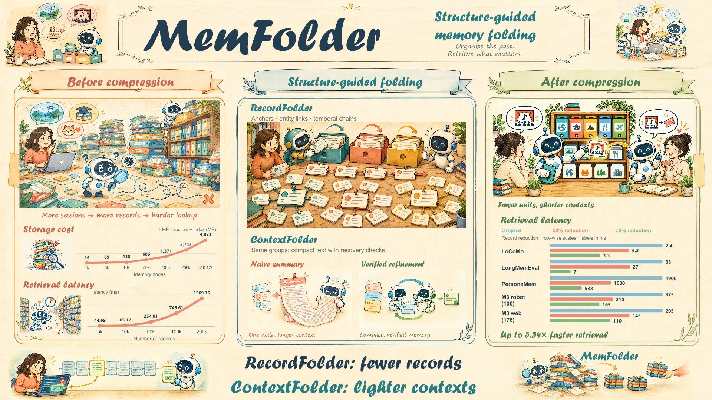
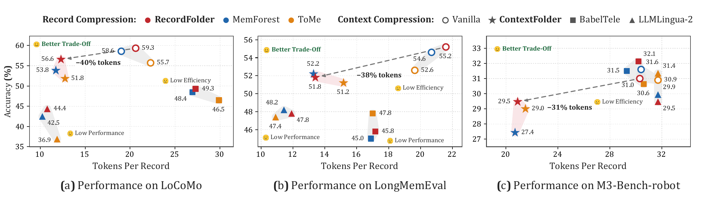
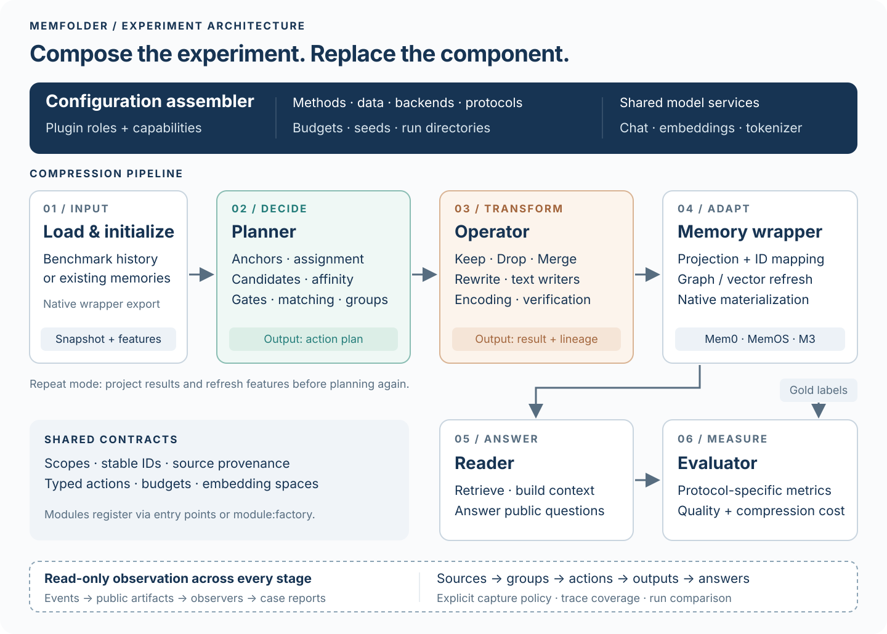

<div align="center">



# MemFolder

**Structure-Guided Memory Folding for Efficient Agent Memory Management**

Paper companion code · Composable infrastructure for memory compression research

[](https://github.com/xuyang-liu16/MemFolder/actions/workflows/tests.yml) [](pyproject.toml) [](#paper) [](#documentation)

[Paper](#paper) · [Main results](#main-results) · [Architecture](#architecture) · [Quick start](#quick-start) · [Compose](#compose-an-experiment) · [Extend](#extend-one-module) · [Case analysis](#inspect-the-data-flow)

</div>

MemFolder compresses an agent's existing memory store along two dimensions: **how many records the store contains, and how much text each record carries**. RecordFolder consolidates related memories into shared retrieval units; ContextFolder encodes the original records within those groups into compact text, using factual recovery checks to guide revision.

This repository contains the refactored implementation of the paper's methods and a modular experiment framework. Swap a grouping strategy, context writer, memory backend or evaluation protocol through configuration, and inspect what changed from the original memory to the final answer.

## Paper

**MemFolder: Structure-Guided Memory Folding for Efficient Agent Memory Management**

Long-term memory has two coupled costs. More records enlarge the retrieval search space; longer retrieved records increase the context processed by the agent. Merging records can reduce the first cost while increasing the second. MemFolder connects record consolidation and context compression through shared memory groups.

### Method overview

<div align="center">
<a href="docs/assets/paper-overview.pdf"></a>
</div>

**Paper method figure.** RecordFolder folds related records into fewer retrieval units. ContextFolder reuses those groups for compact encoding with factual recovery checks. Click the figure for the original PDF.

| Component | What it does | Replaceable parts |
| --- | --- | --- |
| **RecordFolder** | Grounds entities, selects complementary anchors, and refines groups through semantic/entity affinity and temporal chains. Each group becomes one retrieval unit. | Anchor selection, assignment, candidates, affinity, gating, matching and group routing |
| **ContextFolder** | Encodes each group's original records under a target token ratio, checks fact recovery from the encoding, and revises candidates using feedback. | Fact planning, triage, encoding, verification, feedback and round selection |

ContextFolder can use groups produced by other record compression methods. Its internal verification questions are derived from source memories; benchmark questions and gold answers remain outside compression.

The public paper link, author list and citation will be added when available.

## Main results

Results below come from the supplied manuscript tables and figures. Record-count reduction and tokens per record are separate compression measures. [All main-result tables](docs/PAPER_RESULTS.md) include every reported ratio and category; [the data file](docs/assets/paper-results-data.json) preserves exact values and source provenance. These are paper-reported results, not independently reproduced scores from this refactored release.

### Record compression

With **50% fewer records on Mem0**, RecordFolder retains **99.0%** of the uncompressed average accuracy across LoCoMo, LongMemEval and PersonaMem. The table below shows overall accuracy; the bold row identifies our method. Retention is relative to uncompressed Mem0.

| Method | LoCoMo | LongMemEval | PersonaMem | Avg. | Retention (%) |
| --- | ---: | ---: | ---: | ---: | ---: |
| Mem0 (uncompressed) | 60.2 | 55.2 | 67.9 | 61.1 | 100.0 |
| Random Pruning | 43.1 | 43.6 | 64.3 | 50.3 | 82.3 |
| KMeans | 46.8 | 47.0 | 65.2 | 53.0 | 86.7 |
| DART | 51.9 | 41.4 | 64.3 | 52.5 | 85.9 |
| Random Merging | 51.4 | 48.6 | 64.5 | 54.8 | 89.7 |
| ToMe | 54.7 | 50.8 | 65.9 | 57.1 | 93.5 |
| MemForest | 58.4 | 51.8 | 67.7 | 59.3 | 97.1 |
| **MemFolder (RecordFolder)** | **59.3** | **55.0** | **67.2** | **60.5** | **99.0** |

<details>
<summary><b>Across record budgets and memory frameworks</b></summary>

| Memory framework | Records removed | Uncompressed avg. | RecordFolder avg. | Retention (%) |
| --- | ---: | ---: | ---: | ---: |
| Mem0 | 30% | 61.1 | 61.5 | 100.7 |
| Mem0 | 50% | 61.1 | 60.5 | 99.0 |
| Mem0 | 70% | 61.1 | 59.0 | 96.6 |
| MemOS | 50% | 71.1 | 64.7 | 91.0 |
| MemOS | 70% | 71.1 | 60.3 | 84.8 |
| M3-Agent | 50% | 39.1 | 39.6 | 101.3 |
| M3-Agent | 70% | 39.1 | 40.1 | 102.6 |

The complete baseline comparisons and category breakdowns for **Mem0 (30/50/70%)**, **MemOS (50/70%)** and **M3-Agent (50/70%)** are in [the full result tables](docs/PAPER_RESULTS.md).

</details>

### Context compression

<div align="center">
<a href="docs/assets/paper-context-results.pdf"></a>
</div>

**Accuracy versus tokens per record at 50% record-count reduction.** Upper left is better. Colors identify the record compressor; markers identify the context compressor. After RecordFolder, ContextFolder further reduces tokens per record by **40.3% on LoCoMo** and **37.9% on LongMemEval**, with final accuracy of **56.6%** and **51.8%**, respectively. These token reductions are relative to RecordFolder alone.

### Retrieval efficiency

<div align="center">
<a href="docs/assets/paper-retrieval-efficiency.pdf"></a>
</div>

**Mean and P95 retrieval latency.** Keeping 30% of records yields the paper-reported **1.88–5.34×** mean speedups across five settings. The horizontal axis shows records **retained**, whereas the result tables state records **removed**.

## Architecture

<div align="center">

</div>

The **Planner decides what to compress** and produces an action plan. The **Operator executes those actions**. The **Wrapper preserves framework-specific storage and graph semantics**. The **Reader and Evaluator define retrieval, answering and scoring**. Each role can come from a separate plugin package.

- **Compose small changes.** Replace a candidate scorer or fact verifier without
  copying a whole baseline.
- **Separate memory and evaluation.** A benchmark can reuse a native memory loader.
  Gold answers are supplied only to the Evaluator.
- **Track the experiment.** Record source fingerprints, component identities,
  budgets and artifacts; verify and resume completed runs.
- **Explain the result.** Trace sources, decisions, output memories, retrieval hits
  and answers through external analysis hooks.

### Available building blocks

| Dimension | Implementations |
| --- | --- |
| Paper methods | **RecordFolder**, **ContextFolder** |
| Record compression baselines | ToMe, MemForest, DART memory adaptations, StreamMeCo graph compression, RandomMerge, RandomPrune, KMeansMerge, KMeansPrune |
| Benchmark loaders and evaluation protocols | LoCoMo, PersonaMem, LongMemEval, M3-Bench robot/web |
| Memory loading and wrappers | Mem0, MemOS, M3 |
| Experiment and analysis tools | Configuration assembly, matrices, uncompressed controls, artifact verification, completed-run resume, observers and case queries |

Combinations must satisfy graph, time, modality and embedding requirements. DART denotes the memory adaptations; StreamMeCo covers its graph compression stage. MemForest's MST implementation and historical M3 proxy have separate recipes. See [compatibility](docs/COMPATIBILITY.md) and [method variants](docs/COMPRESSION.md) for the exact scope.

## Quick start

### 1. Install

Requires **Python 3.11+**. The core package has no mandatory third-party dependencies.

```bash
git clone https://github.com/xuyang-liu16/MemFolder.git
cd MemFolder
python -m pip install -e .
```

### 2. Run an offline experiment

```bash
python -m memfolder run examples/experiments/offline-demo.json
python -m memfolder verify build/experiments/offline-demo
```

The demo runs loading → compression → native output → retrieval → answering → evaluation, with an uncompressed control and case traces. It uses synthetic histories, concatenation and a context-echo answerer; no API key or model is required. Scores are marked `test_only` and validate the workflow.

Run a small matrix of two methods and two seeds:

```bash
python -m memfolder matrix examples/experiments/offline-matrix.json
```

Artifacts stay under `build/experiments/`. Reuse a completed run with `--resume` and the same configuration; verification checks recorded inputs and artifacts.

### 3. Connect real memories and models

```bash
python -m pip install -e ".[algorithms,contextfolder,qdrant,evaluation]"
```

Start from the [RecordFolder template](examples/experiments/recordfolder-template.json) or [ContextFolder template](examples/experiments/contextfolder-template.json). Set data and output paths, the wrapper, provider URLs, model revisions and embedding space. Credentials are read from environment variables. The templates contain explicit placeholders that must be replaced.

For an existing library, use a [native loader](docs/LOADING.md) with the `bank-initializer`. The [experiment guide](docs/EXPERIMENTS.md) explains assembly; the [wrapper guide](docs/WRAPPERS.md) covers Mem0, MemOS and M3 formats.

## Compose an experiment

**Record grouping and context writing are independent choices.** For example, use ToMe's grouping with ContextFolder's encoding by updating these fields in a complete ContextFolder experiment configuration:

```json
{
  "compression": {
    "planner": {"plugin": "tome"},
    "operator": {"plugin": "contextfolder-operator"}
  },
  "run": {
    "mode": "repeat",
    "budgets": [{"unit": "nodes", "ratio": 0.5}]
  }
}
```

This is a **configuration fragment**: keep the template's features, wrapper, services, Reader and Evaluator. ToMe text compression uses repeated rounds with fresh embeddings of rewritten text. A node ratio of `0.5` is a record budget; ContextFolder's token target is configured separately and is a soft target. See the [ToMe + ContextFolder recipe](examples/recipes/tome-with-contextfolder.json).

Experiment [matrices](examples/experiments/offline-matrix.json) vary configuration paths and seeds. Set `run.evaluate_source` to `true` for an uncompressed-memory control using the same Reader and Evaluator. Keep retrieval, QA prompts and scoring fixed when measuring the effect of compression.

## Extend one module

A new method can be a complete Planner, a different Operator, or a replacement for one nested component. Implement its interface and a factory with a `PluginSpec`, then select it through configuration:

```json
{
  "plugin": "my_module:build",
  "parameters": {"my_parameter": 0.5}
}
```

An installed package can register a `memfolder.plugins` entry point. The assembler checks roles, API versions and capabilities. The core Runner does not need a new method-name or benchmark-name branch.

| Your contribution | Starting point |
| --- | --- |
| A new benchmark loader | [Standalone benchmark plugin](examples/plugins/new_benchmark) |
| A new anchor-selection rule | [Recency component](examples/plugins/recency) |
| A different framework output writer | [Native writer plugin](examples/plugins/native_writer) |
| A new answerer, metric or observer | [Experiment component plugins](examples/plugins/experiment_components) |

The [extension guide](docs/EXTENDING.md) covers factories, entry points and validation. Contributed plugins should include a small synthetic fixture, declare requirements, preserve source identities and test their own behavior.

## Inspect the data flow

Observers receive read-only events and public artifacts, and write their own reports. They inspect compression without feeding decisions back into it. Capture profiles control recorded stages, samples, text and vectors.

```json
{
  "capture": {"profile": "cases", "text_policy": "omit"},
  "observers": [{"plugin": "event-report-observer", "required": false}]
}
```

With [`FileRunReader`](docs/ANALYSIS.md), follow a source memory through grouping, actions and outputs, inspect a question's retrieval and answer, or compare runs by source identity. Missing observations are explicitly marked; traces do not invent explanations for unrecorded decisions.

Capture policies control public analysis projections. Private experiment artifacts still contain the corresponding source memories and evaluation data.

## Documentation

| I want to… | Guide |
| --- | --- |
| Run experiments and parameter sweeps | [Experiments](docs/EXPERIMENTS.md) |
| Browse paper figures and all main-result tables | [Paper results](docs/PAPER_RESULTS.md) |
| Understand methods and baseline variants | [Compression](docs/COMPRESSION.md) |
| Load an existing memory library | [Memory loading](docs/LOADING.md) |
| Parse a benchmark and select a scoring protocol | [Benchmarks](docs/BENCHMARKS.md) |
| Export to a memory framework | [Wrappers](docs/WRAPPERS.md) |
| Add a component or inspect cases | [Extensions](docs/EXTENDING.md) · [Analysis](docs/ANALYSIS.md) |
| Check interfaces and supported combinations | [Contracts](docs/CONTRACTS.md) · [Compatibility](docs/COMPATIBILITY.md) |

<details>
<summary><b>Repository map</b></summary>

```text
src/memfolder/
  core/          Versioned contracts and invariants
  loading/       Native memory readers and format adapters
  benchmarks/    Dataset parsing and evaluation separation
  planning/      Planners and decision components
  operators/     Pruning, merging and context encoding
  wrappers/      Projection, native encoding and materialization
  evaluation/    Retrieval, answering, prompts and metrics
  analysis/      Events, observers, traces and case queries
  assembly.py    Compression pipeline assembly
  experiment.py  Complete offline experiments
  matrix.py      Configuration and seed sweeps
examples/        Recipes, full configurations and external plugins
schemas/         Public wire formats
tests/           Contracts, components and integration checks
docs/            Module guides, diagrams and provenance
```

</details>

## Development

After installing the optional dependencies, run:

```bash
python tools/fetch_test_sources.py
python tools/check_contracts.py
```

The source fetcher verifies pinned upstream revisions and checksums; downloads stay in ignored `build/` directories. Without that download, optional upstream integration checks skip explicitly. Historical-archive tests also skip when their separate source archives are unavailable. CI runs checks and the offline workflow on Python 3.11 and 3.12.

This is a development release of the refactored framework. Full paper-score reproduction, live backend integration and multimodal inference require their own environment-specific validation. See the [current validation scope](docs/EXPERIMENTS.md#验证范围).

## Acknowledgements and licensing

This project builds on the systems, benchmarks and compression methods documented in [method provenance](docs/METHOD_PROVENANCE.json), [benchmark sources](docs/BENCHMARK_SOURCES.json) and [wrapper sources](docs/WRAPPER_SOURCES.json). RecordFolder and ContextFolder are the formal names of the earlier G1S and V12 implementations.

Third-party attribution and adaptation details are preserved in [the notices](docs/THIRD_PARTY_NOTICES.md), including StreamMeCo's MIT notice. A uniform distribution license for the historical source contributions has not yet been finalized; this release does not relicense them.
