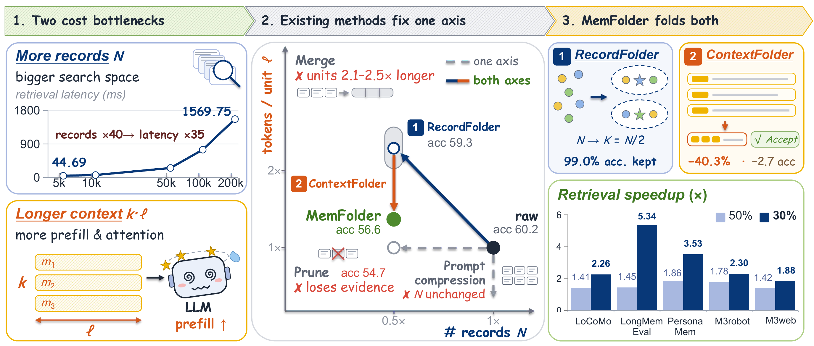
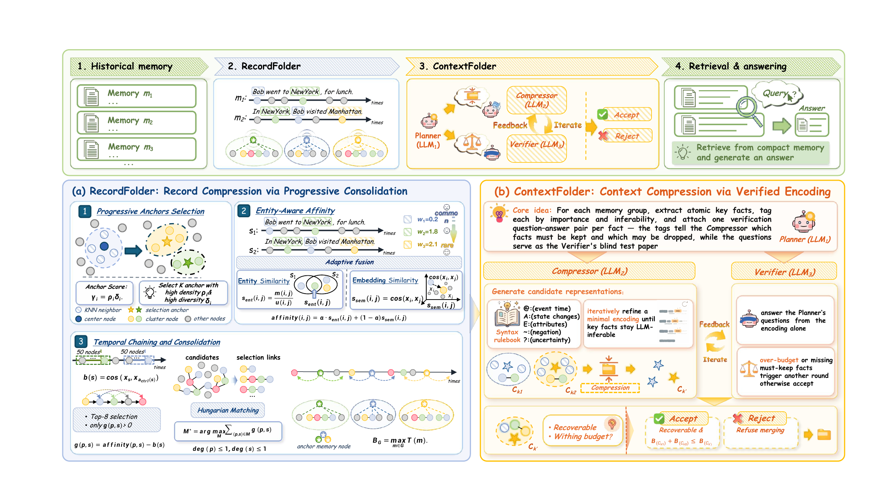
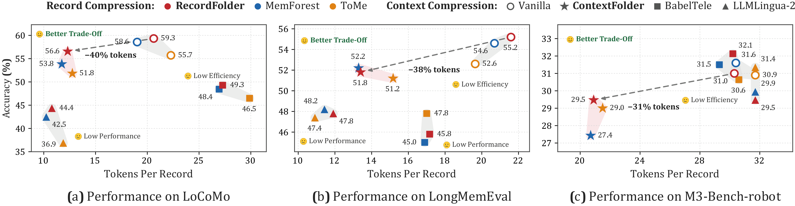
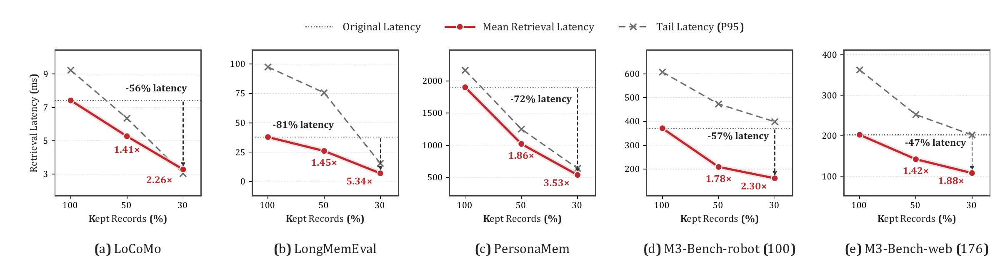

<div align="center">

# MemFolder

**Structure-Guided Memory Folding for Efficient Agent Memory Management**

**结构引导的记忆折叠：面向智能体的高效记忆管理**

压缩历史记忆，检索相关内容，用更短的上下文回答问题。

[](https://github.com/xuyang-liu16/MemFolder/actions/workflows/tests.yml) [](pyproject.toml) [](docs/zh-CN/README.md)

[English](README.md) | **简体中文**

[最新动态](#news) · [核心亮点](#highlights) · [方法概览](#overview) · [使用说明](#usage) · [全部结果](#full-results)

</div>

<div align="center">
<a href="docs/assets/paper-intro.png"></a>
</div>

**摘要图。** RecordFolder 减少需要检索的记录数量；ContextFolder 缩短每条记录的内容，并通过事实恢复检查指导编码。

<a id="news"></a>

## 最新动态

- **2026-10-08：** 更新项目概览、实验指南和完整论文结果，并提供中英文文档。

<a id="highlights"></a>

## 核心亮点

- **同时压缩记录数量和文本长度。** RecordFolder 整合相关记忆；ContextFolder 缩短每组记忆的文本，并检查其中的重要事实能否恢复。
- **用更少的记录保持问答效果。** 缩减 50% 记录后，RecordFolder 在 LoCoMo、LongMemEval 和 PersonaMem 上保留了原始 Mem0 系统 **99.0%** 的平均准确率。
- **缩短模型需要读取的上下文。** 在相同记录预算下，ContextFolder 相比单独使用 RecordFolder，进一步将 LoCoMo 和 LongMemEval 的每条记录 token 数降低 **40.3%** 和 **37.9%**。
- **加快检索。** 保留 30% 记录时，论文的五个评测设置中最高取得 **5.34×** 的平均检索加速。

本页图表和数值来自论文实验。仓库提供可配置的压缩方法、数据加载和评测工具，供你运行自己的对比实验。

<a id="overview"></a>

## Overview · 方法概览

随着交互积累，智能体需要搜索更多记忆，也需要读取更长的文本。MemFolder 分两步降低这些开销：先把相关记录整合为更少的检索单元，再将每个单元的内容编码为更短的文本。

下方主图展示了完整流程：

1. **载入历史记忆。** 保留记录内容、实体、事件时间和来源信息。
2. **RecordFolder 分组整合。** 选择代表性记忆，结合实体相似度、语义相似度和时间关系，将相关记录归为一组。
3. **ContextFolder 编码与验证。** 提取关键事实，生成紧凑文本，再让验证模型根据编码回答事实问题，用回答结果指导修订。
4. **检索与回答。** 从压缩后的记忆中查找相关内容，交给问答模型生成答案。

<div align="center">
<a href="docs/assets/paper-overview.pdf"></a>
</div>

**方法主图。** 下方分别展开 RecordFolder 的锚点选择与时间链整合，以及 ContextFolder 的事实规划、编码与验证。点击图片可查看 PDF；实现和配置见[压缩方法](docs/zh-CN/COMPRESSION.md)。

<a id="usage"></a>
<a id="quick-start"></a>

## 使用说明

### 安装并运行示例

使用 Python 3.11 或更新版本，在终端执行：

```bash
git clone https://github.com/xuyang-liu16/MemFolder.git
cd MemFolder
python -m pip install -e .
python -m memfolder run examples/experiments/offline-demo.json
python -m memfolder verify build/experiments/offline-demo
```

示例使用一段简短的合成对话，在本地完成记忆分组、保存、检索和评分。结果与过程记录写入 `build/experiments/offline-demo`。其中标为 `test_only` 的分数用于检查运行流程。

### 运行 RecordFolder 或 ContextFolder

先安装实验模板使用的依赖：

```bash
python -m pip install -e ".[algorithms,contextfolder,evaluation]"
```

打开 [recordfolder-template.json](examples/experiments/recordfolder-template.json) 或 [contextfolder-template.json](examples/experiments/contextfolder-template.json)，填写数据集路径、服务地址、模型名称与版本、向量维度和输出目录。在当前终端通过 `MEMFOLDER_PROVIDER_KEY` 设置 API 密钥；具体字段和终端命令见[实验指南](docs/zh-CN/EXPERIMENTS.md)。

完成配置后运行：

```bash
python -m memfolder run examples/experiments/recordfolder-template.json
python -m memfolder run examples/experiments/contextfolder-template.json
```

两个模板都保留一半可压缩记录，并分别评测原始记忆和压缩后的记忆。ContextFolder 还会使用配置的 tokenizer 统计文本长度。已有 Mem0、MemOS 或 M3 记忆库时，按[加载指南](docs/zh-CN/LOADING.md)接入。

默认[文本 ToMe](docs/TOME_TEMPORAL_CONTRACT.md)已改为按时间连续二分、逐对合并，并立即更新目的节点向量；历史交错 BSM 变体命名为 `tome-bsm`。[LLMLingua-2 Context 阶段](docs/LLMLINGUA2.md)独立压缩最终 Record 文本，默认保留率 **0.55**。下方表格保留论文报告时的设置；修改参数和方法后的实验结果使用单独的身份与记录。

### 对比实验与查看案例

```bash
python -m memfolder matrix examples/experiments/offline-matrix.json
python -m memfolder run examples/experiments/offline-demo.json --resume
python -m memfolder case build/experiments/offline-demo --dataset-id locomo --sample-id demo --question-id demo:0 --output build/cases/demo-question
```

矩阵示例比较两种方法和两个随机种子。`--resume` 检查输入和结果文件后，复用已经完成的实验。`case` 命令导出某道问题相关的记录与事件。每次新实验或案例导出都使用新的输出目录。

<a id="documentation"></a>

### 文档导航

| 任务 | 指南 |
| --- | --- |
| 配置与运行实验 | [实验指南](docs/zh-CN/EXPERIMENTS.md) |
| 选择压缩方法 | [压缩方法](docs/zh-CN/COMPRESSION.md) |
| 加载记忆与评测答案 | [记忆加载](docs/zh-CN/LOADING.md) · [基准与评测](docs/zh-CN/BENCHMARKS.md) |
| 将结果写回框架格式 | [框架接入](docs/zh-CN/WRAPPERS.md) |
| 分析问答过程或添加组件 | [运行分析](docs/zh-CN/ANALYSIS.md) · [组件扩展](docs/zh-CN/EXTENDING.md) |
| 查看数据类型与支持范围 | [数据与接口](docs/zh-CN/CONTRACTS.md) · [支持的配置](docs/zh-CN/COMPATIBILITY.md) |

[文档索引](docs/zh-CN/README.md)提供了按任务组织的阅读路径。代码来源与署名见[第三方说明](docs/THIRD_PARTY_NOTICES.md)；历史代码的统一许可仍在确认中。

<a id="main-results"></a>
<a id="full-results"></a>

## 全部结果

以下图表展示记录压缩、上下文压缩和检索效率，数值均来自论文。[完整结果表](docs/zh-CN/PAPER_RESULTS.md)包含各类别的细分分数，[数据文件](docs/assets/paper-results-data.json)保留精确数值与来源。

### RecordFolder：记录压缩

准确率、平均准确率和保留率均以百分比表示。**性能保留率**是压缩后的平均准确率相对于原始系统的比例。**缩减 70% 记录**对应**保留 30% 记录**。加粗行表示 RecordFolder，在论文表格中记作 MemFolder。

#### Mem0 · 缩减 50% 记录

| 方法 | LoCoMo | LongMemEval | PersonaMem | 平均准确率 | 性能保留率 (%) |
| --- | ---: | ---: | ---: | ---: | ---: |
| Mem0（未压缩） | 60.2 | 55.2 | 67.9 | 61.1 | 100.0 |
| Random Pruning | 43.1 | 43.6 | 64.3 | 50.3 | 82.3 |
| KMeans | 46.8 | 47.0 | 65.2 | 53.0 | 86.7 |
| DART | 51.9 | 41.4 | 64.3 | 52.5 | 85.9 |
| Random Merging | 51.4 | 48.6 | 64.5 | 54.8 | 89.7 |
| ToMe | 54.7 | 50.8 | 65.9 | 57.1 | 93.5 |
| MemForest | 58.4 | 51.8 | 67.7 | 59.3 | 97.1 |
| **MemFolder (RecordFolder)** | **59.3** | **55.0** | **67.2** | **60.5** | **99.0** |

<details>
<summary><b>Mem0 · 30 / 70% 记录缩减</b></summary>

#### Mem0 · 缩减 30% 记录

| 方法 | LoCoMo | LongMemEval | PersonaMem | 平均准确率 | 性能保留率 (%) |
| --- | ---: | ---: | ---: | ---: | ---: |
| Mem0（未压缩） | 60.2 | 55.2 | 67.9 | 61.1 | 100.0 |
| Random Pruning | 50.8 | 50.8 | 64.5 | 55.4 | 90.7 |
| KMeans | 56.8 | 52.0 | 65.7 | 58.2 | 95.3 |
| DART | 57.4 | 48.8 | 66.6 | 57.6 | 94.3 |
| Random Merging | 56.2 | 50.8 | 65.2 | 57.4 | 93.9 |
| ToMe | 57.2 | 51.2 | 66.4 | 58.3 | 95.4 |
| MemForest | 58.5 | 54.2 | 66.6 | 59.7 | 97.7 |
| **MemFolder (RecordFolder)** | **61.7** | **55.2** | **67.7** | **61.5** | **100.7** |

#### Mem0 · 缩减 70% 记录

| 方法 | LoCoMo | LongMemEval | PersonaMem | 平均准确率 | 性能保留率 (%) |
| --- | ---: | ---: | ---: | ---: | ---: |
| Mem0（未压缩） | 60.2 | 55.2 | 67.9 | 61.1 | 100.0 |
| Random Pruning | 33.1 | 28.6 | 63.7 | 41.8 | 68.4 |
| KMeans | 36.7 | 34.8 | 63.8 | 45.1 | 73.8 |
| DART | 43.6 | 30.6 | 61.8 | 45.3 | 74.1 |
| Random Merging | 50.7 | 46.2 | 64.0 | 53.6 | 87.7 |
| ToMe | 52.7 | 49.6 | 65.7 | 56.0 | 91.7 |
| MemForest | 54.4 | 52.2 | 64.4 | 57.0 | 93.3 |
| **MemFolder (RecordFolder)** | **57.1** | **55.0** | **64.9** | **59.0** | **96.6** |

</details>

<details>
<summary><b>MemOS · 50 / 70% 记录缩减</b></summary>

#### MemOS · 缩减 50% 记录

| 方法 | LoCoMo | LongMemEval | PersonaMem | 平均准确率 | 性能保留率 (%) |
| --- | ---: | ---: | ---: | ---: | ---: |
| MemOS（未压缩） | 79.0 | 74.0 | 60.3 | 71.1 | 100.0 |
| Random Pruning | 65.3 | 47.8 | 55.9 | 56.3 | 79.2 |
| KMeans | 67.8 | 47.6 | 54.7 | 56.7 | 79.7 |
| DART | 70.1 | 40.8 | 53.7 | 54.9 | 77.2 |
| Random Merging | 73.3 | 59.6 | 56.2 | 63.0 | 88.7 |
| ToMe | 71.0 | 61.8 | 57.9 | 63.6 | 89.4 |
| MemForest | 76.0 | 60.0 | 54.8 | 63.6 | 89.5 |
| **MemFolder (RecordFolder)** | **75.3** | **64.2** | **54.7** | **64.7** | **91.0** |

#### MemOS · 缩减 70% 记录

| 方法 | LoCoMo | LongMemEval | PersonaMem | 平均准确率 | 性能保留率 (%) |
| --- | ---: | ---: | ---: | ---: | ---: |
| MemOS（未压缩） | 79.0 | 74.0 | 60.3 | 71.1 | 100.0 |
| Random Pruning | 54.9 | 30.2 | 52.8 | 46.0 | 64.7 |
| KMeans | 57.3 | 31.6 | 52.6 | 47.2 | 66.4 |
| DART | 59.8 | 26.8 | 48.9 | 45.2 | 63.5 |
| Random Merging | 68.1 | 53.8 | 54.0 | 58.6 | 82.5 |
| ToMe | 67.4 | 53.4 | 55.4 | 58.7 | 82.6 |
| MemForest | 70.7 | 50.0 | 55.5 | 58.7 | 82.6 |
| **MemFolder (RecordFolder)** | **71.3** | **54.4** | **55.2** | **60.3** | **84.8** |

</details>

<details>
<summary><b>M3-Agent · 50 / 70% 记录缩减</b></summary>

#### M3-Agent · 缩减 50% 记录

| 方法 | Robot | Web | 平均准确率 | 性能保留率 (%) |
| --- | ---: | ---: | ---: | ---: |
| M3-Agent（未压缩） | 30.3 | 47.9 | 39.1 | 100.0 |
| Random Pruning | 28.1 | 41.2 | 34.7 | 88.7 |
| KMeans | 29.2 | 43.9 | 36.6 | 93.6 |
| DART | 29.1 | 43.1 | 36.1 | 92.3 |
| StreamMeCo | 30.6 | 44.7 | 37.7 | 96.2 |
| Random Merging | 30.8 | 44.6 | 37.7 | 96.4 |
| ToMe | 30.9 | 46.1 | 38.5 | 98.5 |
| MemForest | 31.6 | 46.5 | 39.0 | 99.7 |
| **MemFolder (RecordFolder)** | **31.0** | **48.2** | **39.6** | **101.3** |

#### M3-Agent · 缩减 70% 记录

| 方法 | Robot | Web | 平均准确率 | 性能保留率 (%) |
| --- | ---: | ---: | ---: | ---: |
| M3-Agent（未压缩） | 30.3 | 47.9 | 39.1 | 100.0 |
| Random Pruning | 27.7 | 37.3 | 32.5 | 83.1 |
| KMeans | 28.9 | 39.1 | 34.0 | 87.0 |
| DART | 27.2 | 39.2 | 33.2 | 84.9 |
| StreamMeCo | 28.4 | 41.9 | 35.1 | 89.8 |
| Random Merging | 30.4 | 43.2 | 36.8 | 94.1 |
| ToMe | 30.6 | 45.7 | 38.2 | 97.7 |
| MemForest | 30.7 | 46.3 | 38.5 | 98.5 |
| **MemFolder (RecordFolder)** | **31.4** | **48.7** | **40.1** | **102.6** |

</details>

### ContextFolder：上下文压缩

<div align="center">
<a href="docs/assets/paper-context-results.pdf"></a>
</div>

**固定缩减 50% 记录，比较准确率与每条记录的 token 数。** 越靠左上越好；颜色表示记录压缩方法，标记表示上下文压缩方法。ContextFolder 在 RecordFolder 的基础上，进一步将 LoCoMo 和 LongMemEval 的每条记录 token 数降低 **40.3%** 和 **37.9%**，最终准确率分别为 **56.6%** 和 **51.8%**。这里的 token 降幅以仅使用 RecordFolder 为参照。

### 检索效率

<div align="center">
<a href="docs/assets/paper-retrieval-efficiency.pdf"></a>
</div>

**平均检索时延与 P95 时延。** 保留 30% 记录时，论文在五个设置中报告了 **1.88–5.34×** 的平均检索加速。图中横轴表示**保留比例**，上面的表格表示**缩减比例**。点击图片可查看原始 PDF。

论文表格与上下文结果图的部分 LongMemEval 参考分数存在差异；这里分别保留原稿数值，具体见[来源一致性说明](docs/zh-CN/PAPER_RESULTS.md#source-consistency)。
